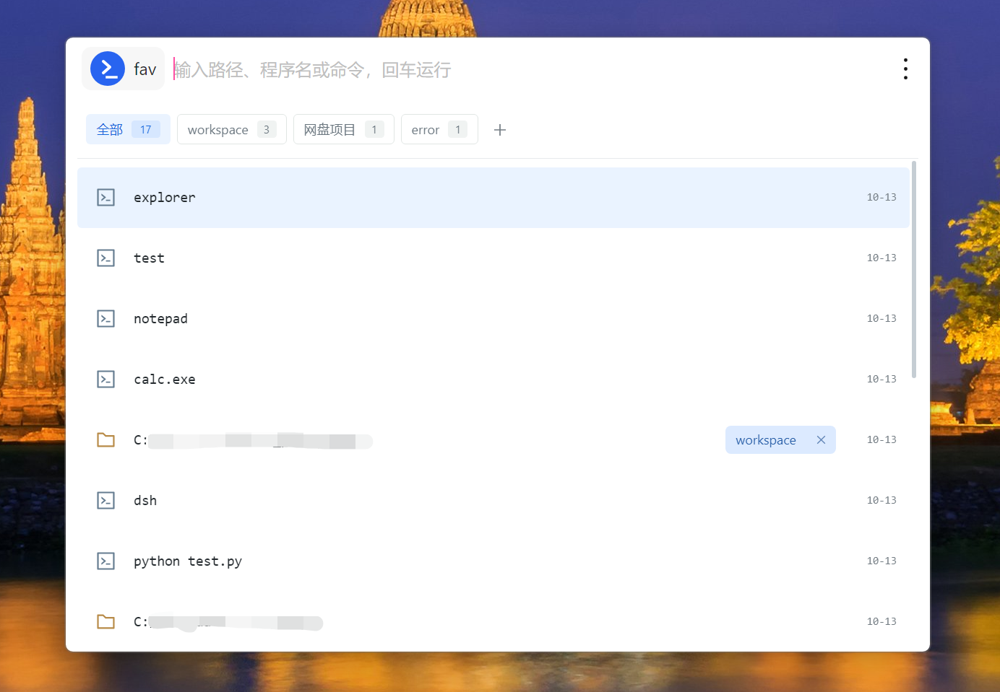

# Startup Favorites

[简体中文](README.md) | **English**

Startup Favorites is a Rubick plugin that turns paths and commands into searchable, taggable launch history. It reuses Rubick's search box, so you type once and press Enter to launch.



- Rubick search keywords: `运行`, `启动`, `start`, `fav`
- Plugin version: `26.10.13`
- Developed and verified with Rubick 4.3.8

## Install

Run these commands from the project directory:

```powershell
npm run deps
npm test
npm run install:rubick
```

After installation, search for `fav` in Rubick to open Startup Favorites. After changing source code, rebuild and reopen the plugin. Reinstall after changing plugin registration metadata.

```powershell
npm run check:rubick       # Check the junction and Rubick registry entry
npm run uninstall:rubick   # Uninstall the plugin
```

## Usage

The Rubick search box is the only command input. The list contains recently launched paths and commands, organized with tags.

| Action | Behavior |
| --- | --- |
| Type text | Shows and selects the current input as the first row; fuzzy-matching history appears below |
| Enter | Launches the selected row; the input row is selected by default, so Enter launches the typed text |
| `Down` / `Up` | Move selection between the input row and matching history |
| Click a history row | Launch that entry directly |
| Click a tag above the list | Filter by tag; text search and tag filtering can be combined |
| Click `+` above the list | Create an empty tag |
| Right-click a history row | Open tag management; copy or delete the entry |
| Right-click a tag above the list | Rename or delete the tag |
| `Esc` | Clear the search box |

The input row is temporary: it is not saved before launch and has no tags or context menu. It becomes history only after the launcher confirms that the entry exists and the launch process was created successfully. The search box is cleared after launch to prevent accidental repeats.

## Launch And Errors

- Folder paths accept forward slashes, backslashes, repeated separators, and UNC format. They are normalized to Windows paths and passed to Explorer.
- Commands launch in a separate visible CMD window. The tool's eventual exit code does not determine whether the launcher succeeded. Interactive tools such as Python and IPython may keep running; a tool's own message, such as `dsh` reporting a missing option, does not prevent the entry from being recorded.
- Bare commands are checked with `where.exe`; executable paths are checked for file existence; CMD built-ins are recognized from a built-in command list. For compound commands, only the first entry is checked and CMD handles the remaining syntax.
- If an entry cannot be found or the launch process cannot be created, the plugin stays open, shows an error, and does not create a new history entry.
- If a previously recorded entry fails to launch, its timestamp is updated and a red `error` tag is added. A later successful launch removes `error`. The timestamp represents the latest attempt.
- After a successful launch, the Rubick window is hidden before the plugin view exits.

Successful launch means the entry is available and the process was created. It does not guarantee that the program's later operations or business task succeeded. Commands run with the current Windows user's permissions; only launch trusted input.

## History And Tags

- Untagged history is limited to 500 entries; the least recently attempted entries are removed first.
- Tagged entries are exempt from the 500-entry limit and remain until explicitly deleted.
- User tags and the automatic `error` tag share the same record. Removing `error` leaves other tags untouched.
- Entries are sorted by latest attempt time. An entry may have multiple tags.

## Development And Checks

```powershell
npm run serve   # Start the local development server
npm run build   # Build the single-file offline plugin entry
npm test        # Build and run static, model, Windows runtime, and browser tests
```

The build output is `public/index.html`; it is generated and should not be edited directly. The list uses virtual scrolling with a fixed `ROW_H = 56`. Update both the layout and the constant if row height changes.

Before release, run the privacy checks:

```powershell
node tools/privacy-scan.js .
node tools/history-scan.js
```

See [`.agent/manifest.yaml`](.agent/manifest.yaml) for the detailed module index.
